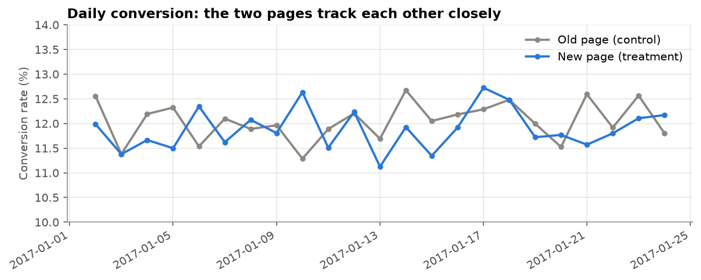

# A/B Test: Should the Online Store Roll Out the New Landing Page?

## 1. Business problem and pre-registration

**Client and context.** The imagined client is a South African online store. Marketing has built a new landing page and believes it converts better than the old one. For three weeks, visitors were randomly shown either the old page (control) or the new page (treatment).

**Question.** Is the difference in conversion real, or noise? Should the store **roll out** the new page, **keep** the old one, or **keep testing**?

**Fixed before looking at any result** (also committed as the first cell of the notebook, before any analysis):

- **Metric:** conversion rate, the share of unique visitors who buy.
- **Null hypothesis H0:** the new page converts at the same rate as the old one (p_new = p_old).
- **Alternative H1:** the conversion rates differ (p_new ≠ p_old). Two-sided, because a new page can also be worse.
- **Significance level:** α = 0.05.
- **Smallest lift worth acting on:** **+0.5 percentage points.** A redesign has development, testing and rollout costs; a smaller lift would not pay for them.
- **Test:** two-proportion z-test with a 95% confidence interval for the difference.

| What the 95% confidence interval for (new - old) shows | Decision |
|---|---|
| Entirely above 0, and reaching +0.5 points | **Roll out** |
| Entirely below +0.5 points | **Do not roll out**: a worthwhile lift is ruled out |
| Includes both 0 and +0.5 points | **Keep testing** |

Writing this down first matters. Choosing the test, the threshold or the success criterion after seeing the data (*p-hacking*) can make almost any result look significant.

**Value of a conversion.** For the rand view I assume an average order of **R450** and about **415,000 visitors a month** (the test saw about 290,000 in three weeks). On those assumptions a +0.5 point lift is worth roughly **R930,000 a month** in extra sales.

## 2. Data

**Source:** `ab_data.csv` and `countries.csv` from Udacity's Data Analyst Nanodegree A/B testing project, published at [github.com/jemc36/Udacity-DAND-AB-test-ecommerce](https://github.com/jemc36/Udacity-DAND-AB-test-ecommerce). 294,478 page views from 2 to 24 January 2017.

| Column | Meaning |
|---|---|
| `user_id` | Visitor ID |
| `timestamp` | When the visitor saw the page |
| `group` | Experiment arm the visitor was assigned to: `control` or `treatment` |
| `landing_page` | The page actually shown: `old_page` or `new_page` |
| `converted` | 1 if the visitor went on to buy, 0 if not |
| `country` | UK, US or CA (from `countries.csv`, joined on `user_id`) |

**In a South African role**, the same analysis would run on the store's own web analytics or experimentation platform data (for example exported page-view and order events), joined on a visitor ID.

## 3. Cleaning and checks

| Issue | Found | Decision |
|---|---|---|
| `group` and `landing_page` disagree (a control visitor saw the new page, or the reverse) | 3,893 rows (1.3%) | **Removed.** We cannot tell whether the assignment or the page shown is wrong, and keeping them would blur the difference being measured. In a real company this routing bug would go to the engineering team. |
| Visitor appears twice | 1 visitor | Kept the first visit: the unit of the test is the person |

**Is the randomisation sound?** After cleaning: 145,274 control and 145,310 treatment visitors. A sample ratio check against 50/50 gives p = 0.95, and the country mix is the same in both groups (p = 0.41). No sign that the assignment was broken, so differences in conversion can be credited to the page.

## 4. Conversion rates

| Page | Visitors | Purchases | Conversion rate |
|---|---|---|---|
| Old (control) | 145,274 | 17,489 | **12.04%** |
| New (treatment) | 145,310 | 17,264 | **11.88%** |
| Difference (new - old) | | | **-0.16 points** |

The new page converts slightly **less**. Over the 21 days the two daily lines cross back and forth, and there is no early spike that fades (which would suggest a novelty effect).
